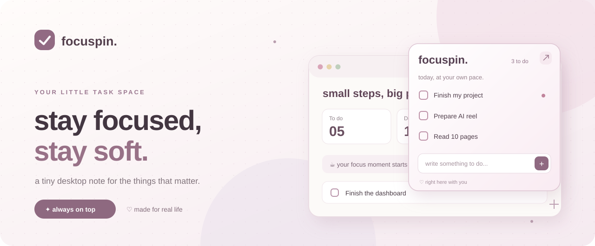
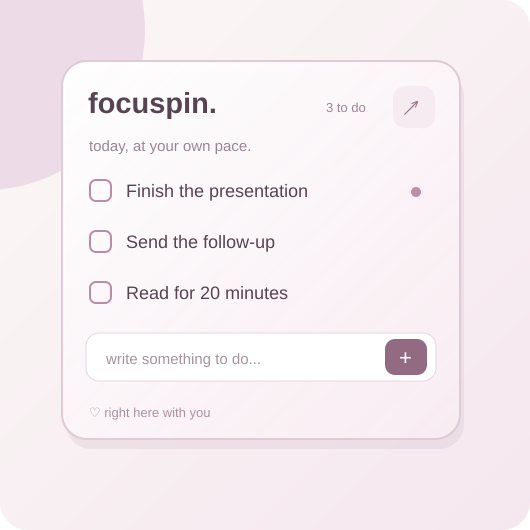
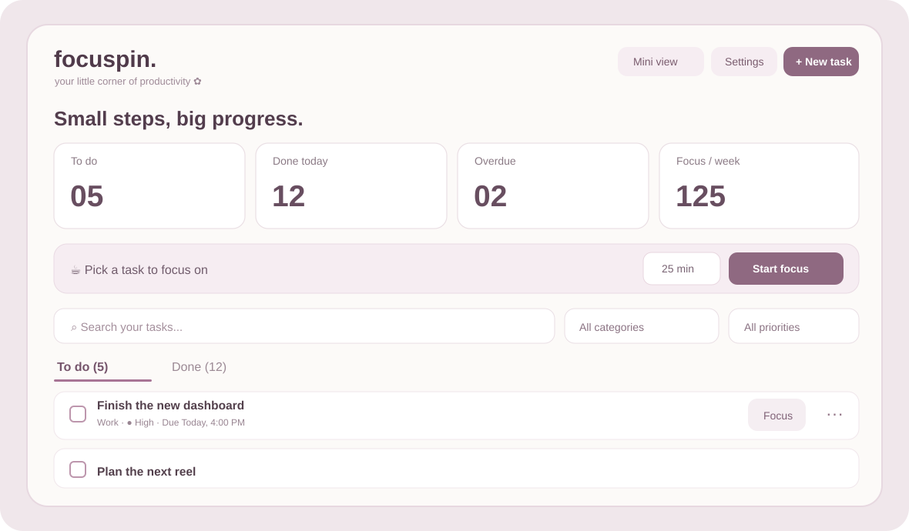

<div align="center">



<br />

### ✿ Your tasks deserve a little space, not another overwhelming app.

**A soft, always-on-top desktop sticky note + an actually useful task manager.**  
Keep it tiny while you work. Open it up when you need the whole picture.


**[✨ Getting started](#-getting-started)** · **[🪄 Features](#-everything-in-one-little-app)** · **[🔔 Reminders](#-the-flash--beep-reminder)** · **[⌨️ Shortcuts](#%EF%B8%8F-shortcuts--safety)**

</div>

---

## 🌷 Meet your new little productivity corner

Ever open 12 tabs, get distracted, and forget the one thing you *actually* needed to finish?

**FocusPin** keeps a tiny, semi-transparent checklist floating over your regular desktop windows. Your unfinished tasks don't disappear just because you opened Chrome, VS Code, or a presentation. No signup, no new browser tab, no unnecessary complexity.

<table>
  <tr>
    <td width="45%" align="center">
      
      <br /><b>☁️ Mini mode</b><br />Just the next few things.
    </td>
    <td width="55%" align="center">
      
      <br /><b>✿ Dashboard mode</b><br />Every detail, when you need it.
    </td>
  </tr>
</table>

> [!NOTE]
> The SVG images above are **design illustrations** of the Pinterest-inspired theme, not pixel-perfect captures of a running Windows session. The Windows GUI still needs hands-on testing.

## 🪄 Everything in one little app

| | Feature | What it does |
|---|---|---|
| 📌 | **Always-on-top mini note** | Keeps your top 3 unfinished tasks above normal desktop apps, in a draggable, translucent note. |
| ✨ | **Calm, minimal interface** | Warm ivory, dusty rose, spacious cards, simpler labels, less clutter. |
| 🗂️ | **To do / Done tabs** | Open the expanded dashboard to see all remaining and completed tasks. |
| 🎀 | **Priority + categories** | High / Medium / Low tasks, custom categories, due dates and notes. |
| 🧩 | **Subtasks** | Break a big task into checkable steps, with progress tracking. |
| 🔁 | **Repeating tasks** | Daily, weekdays, weekly or monthly — next occurrence appears after completion. |
| ☕ | **One-task focus mode** | Focus on a single task with a countdown you can pause or resume. |
| 🔔 | **Flash + beep reminder** | A visible note flash and triple beep after prolonged mouse inactivity. |
| 💤 | **Snooze + control** | Change the timeout, sound, beep interval, color, speed, opacity and volume. |
| 📊 | **Weekly activity** | See completed tasks, overdue items and completed focus-session minutes. |
| 🔎 | **Search and filter** | Find tasks by words, notes, subtasks, category or priority. |
| ↶ | **Undo** | Recover from up to 30 recent task changes in the current session. |
| 💾 | **Local backups** | JSON backups and restore, plus CSV export for your task list. |
| 🔐 | **Easy unlock** | Click-through is optional, has an escape shortcut and automatically unlocks after 10 minutes. |
| 🚀 | **Start with Windows** | Launch automatically when you sign in (optional). |

### 🌸 The two modes

**Mini mode:** finish something without leaving what you're working on. Add a task with the small input, check it off, move the note, or click **↗** to expand it.

**Dashboard mode:** search everything, set priorities, plan due dates, edit subtasks, focus, review completed work, and export a backup. Click **Mini view** to go small again.

---

## 🚀 Getting started

**You need:** Windows 10/11, Python **3.11+**, and internet access once to install `PySide6`.

1. Download or clone the repository and extract/open its folder.
2. Double-click **`START_FOCUSPIN.bat`**.
3. On the first run, it creates a private `.venv` and installs the required dependency.
4. Add a task. Your mini note will float in the top-right of the desktop. 🎉

Prefer the command line?

```powershell
# Run these commands inside the repository folder
py -3 -m venv .venv
.\.venv\Scripts\python.exe -m pip install -r requirements.txt
.\.venv\Scripts\python.exe focuspin.py
```

**Want a standalone `.exe`?** Run `BUILD_EXE.bat` **on Windows**. It creates `dist\FocusPin.exe` with PyInstaller. The repository and ZIP contain source files and build scripts, not a prebuilt Windows executable.

If it won't launch, run **`DEBUG_FOCUSPIN.bat`** and read the error displayed in the console.

### 💗 Already used FocusPin V1?

Your tasks are not supposed to vanish during the upgrade:

1. Quit the old version completely from its system-tray icon.
2. Keep your existing `%APPDATA%\FocusPin\state.json` file in place.
3. Start the new app. It reads the same file, migrates the tasks, and creates a one-time **`state.v1.backup.json`** before rewriting valid V1 data.

> Back up important task data before any upgrade. Don't run V1 and this version simultaneously against the same task file.

---

## 🔔 The flash + beep reminder

**Out of sight ≠ forgotten.** By default, when the mouse stays still for **30 minutes** *and you have an unfinished task*, FocusPin:

- 🟠 Flashes its mini note to catch your attention.
- 🔊 Plays **beep-beep-beep** through your selected Windows audio output.
- 🔁 Repeats the triple tone about every **13 seconds** until your mouse moves, or you stop / snooze the alert.

**Test it without waiting:** click **··· → Test flash + beep (8 seconds)**. It works even with no remaining tasks.

From **Reminder & appearance settings**, you can adjust the idle time, beep tone (Classic / Gentle / Urgent), volume, beep-repeat interval, flash color, speed, note opacity, snooze time and mute mode.

<details>
<summary><b>💭 Why isn't it beeping?</b></summary>

- Make sure Windows isn't muted, speakers/headphones are connected, and FocusPin audio is enabled.
- Automatic reminders need at least one unfinished task; the instant test doesn't.
- Mouse movement stops a live reminder. Being active on your keyboard **without moving the mouse** does not reset this particular timer.
- Focus sessions pause automatic idle reminders. Locking/sleeping your laptop resets inactivity detection when you return.
- If the instant test produces no sound, try another output device or sound profile and use the debug launcher to check for errors.

</details>

## ⌨️ Shortcuts & safety

| Keys / action | Result |
|---|---|
| `Ctrl + Alt + F` | **Show + unlock** the mini note. |
| `Ctrl + Alt + T` | Show + unlock and focus the quick-add field. |
| `Ctrl + Z` *(dashboard)* | Undo the last available task change. |
| **Single-click tray icon** | Show + unlock FocusPin. |
| **Tray → Unlock clicks NOW** | Escape click-through without needing to click the note. |
| **Tray → Quit FocusPin completely** | Fully exit the app. |

Click-through mode is **off by default on launch** and automatically switches off after **10 minutes**. The app won't enable it unless a supported unlock route is available. If another program owns a global shortcut, use the tray icon instead.

> **The close button isn't Quit.** Use the system-tray menu to fully exit, so you don't accidentally lose your always-visible note.

---

## 📂 Where do my tasks live?

```text
%APPDATA%\FocusPin\
├── state.json                # tasks, settings, focus sessions
├── state.v1.backup.json      # V1 safety copy, only if migrated
└── focuspin-v2-beep.wav      # locally generated reminder sound
```

FocusPin stores its tasks locally. It does **not** include a user account, cloud sync, ads, telemetry, or remote task service. Internet is used when `pip` downloads dependencies for first-time setup.

Need a copy? Use **Save backup** to export JSON or **Export CSV** to open your task list in a spreadsheet.

## 🧱 Project structure

```text
FocusPin/
├── focuspin.py              # PySide6 windows, mini note, dialogs and controls
├── core.py                  # storage, migration, recurrence, stats, alert audio
├── assets/
│   ├── focuspin.ico         # app icon
│   ├── focuspin.png
│   ├── focuspin-hero.svg    # GitHub hero illustration
│   ├── focuspin-mini.svg    # GitHub mini-note illustration
│   └── focuspin-dashboard.svg
├── tests/
│   └── test_core.py
├── START_FOCUSPIN.bat        # install dependencies + launch
├── BUILD_EXE.bat            # build standalone Windows EXE
├── DEBUG_FOCUSPIN.bat       # start with visible error output
├── TEST_CORE.bat            # run tests
├── requirements.txt
├── CHANGELOG.md
└── README.md
```

## 🧪 Tests & development

```bash
python -m unittest discover -s tests -v
python -m py_compile core.py focuspin.py
```

The **16 core tests** cover storage, migration, invalid-state recovery, recurring tasks including tricky month ends, stats, CSV export, and generated audio. They are not a substitute for testing the real Windows GUI, tray shortcuts, flashing, or audible playback on a Windows computer.

### 🤝 Contributing

Ideas and improvements are welcome: especially accessibility, polish, Windows testing, and better reminder controls. Please include a brief description and steps to reproduce if reporting a bug.

**License:** No license file is currently included. Add an explicit license before inviting third-party reuse or redistribution.

---

<div align="center">

**made for the easily distracted, the dreamers, and the "just one more tab" people.** ♡

<sub>focuspin. · little progress is still progress ✿</sub>

</div>
